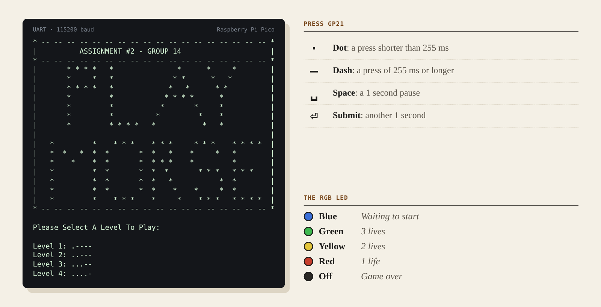
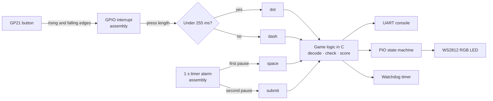

# Morse Code Learning Game

**A four-level game for the Raspberry Pi Pico that teaches Morse code. You tap the answers on a button, and the game is written in C and ARM assembly.**

[](https://github.com/leahweldon/Microprocessor-Systems-Morse-Code-Game/actions/workflows/build.yml)




The game shows you a letter, a number or a word, and you tap its Morse code on the board's GP21 button: a short press for a dot, a long press for a dash. It decodes what you tapped, tells you over the serial console whether you got it right, and shows your remaining lives on the RGB LED. Get five right in a row to move up a level.

We were a team of five, building it over four weeks for CSU23021 Microprocessor Systems at Trinity College Dublin (2023). I was the team's **Code Owner**, responsible for the code's quality, testing and integration, as well as my own parts of the game.

## How to play

1. Tap the number of a level in Morse to choose it: `.----` for level 1, up to `....-` for level 4.
2. Tap the Morse code for the character or word on screen.
3. The console shows what you tapped and what it decodes to, and whether it matched.

| Level | You're asked for | Morse shown? |
|---|---|---|
| 1 | Single characters (A–Z, 0–9) | Yes |
| 2 | Single characters | No |
| 3 | Whole words | Yes |
| 4 | Whole words | No |

You start with three lives. A wrong answer costs one, and a right answer gives one back, up to three. Five right answers in a row takes you to the next level. When you finish a level or run out of lives, the game shows your correct and incorrect answers and your success rate. If you stop playing mid-game, the watchdog timer resets the board to the welcome screen.

## How it works

The time-critical input handling is in ARM assembly; the game logic is in C.



- **Assembly ([`assign02.S`](assign02.S)):** installs its own handlers in the RP2040's vector table for the GPIO interrupt and the timer alarm. The button handler timestamps each press and release to tell dots from dashes. The alarm handler turns one second of silence into a space and a second one into "submit". Between inputs the main loop sleeps with `wfi` (wait for interrupt) rather than busy-waiting.
- **C ([`assign02.c`](assign02.c)):** holds the Morse table for A–Z and 0–9 and a list of words, decodes what was tapped, checks it against the question, and keeps track of lives, streaks, levels and statistics. It also gives the assembly small wrappers around the Pico SDK's GPIO functions.
- **PIO ([`ws2812.pio`](ws2812.pio)):** one of the RP2040's programmable I/O state machines sends the colour data to the WS2812 RGB LED, so the CPU doesn't have to produce the LED's precise timing itself.
- **Watchdog:** resets the board to the welcome screen if a game is left idle.

The firmware takes up about 27 KB of flash and 2.4 KB of RAM.

## Who wrote what

Each function in the source names its author. My parts were:

| Part | What it does |
|---|---|
| `validate_input_sequence()` | Checks your answer against the expected Morse sequence |
| `RGB_update()` and `start_RGB_Colour()` | The LED: blue before a game, then green, yellow, red and off as you lose lives |
| Input handling and interrupts in `assign02.S` | Shared with Faith, Della and Ingrid |

Through all three versions I owned **requirement 5** of the seven the team split the brief into. As Code Owner I also tested each version on our testing branch before it was merged, and tidied and documented the code. See the [project report](docs/Group-14-Project-Report.pdf) and my [contribution declaration](docs/Individual-Contribution-Declaration.pdf).

## Build and flash

**Quickest:** hold BOOTSEL while plugging in the Pico, then drag [`build/assign02.uf2`](build/assign02.uf2) onto the drive that appears. Open a serial terminal at 115200 baud to play.

**From source:** every push builds the firmware in [GitHub Actions](.github/workflows/build.yml) and saves `assign02.uf2` as a downloadable artifact. To build it yourself, you need the Pico SDK (1.5.x), CMake and the ARM GNU toolchain. This folder is a Pico SDK application, so add it to a top-level project:

```cmake
cmake_minimum_required(VERSION 3.13)
include(pico_sdk_import.cmake)
project(morse_game C CXX ASM)
pico_sdk_init()
function(apps_auto_set_url TARGET)   # defined by the course's parent project
endfunction()
add_subdirectory(assign02)           # this repository
```

```bash
cmake -S . -B build -DPICO_SDK_PATH=/path/to/pico-sdk
cmake --build build
```

## How we worked

After a week of research, we built the game in three versions: the core game, then refinement and code review, then the extra levels and statistics. Our process:

- Requirements were split into GitHub issues, each with an owner.
- Everyone worked on feature branches and opened pull requests.
- A dedicated testing branch was where I tested each version before merging.

This repository keeps the team's full Git history, with commits from all five of us.

## Team

**Group 14**

| | Role |
|---|---|
| **Leah Weldon** | Code Owner |
| **Faith Olopade** | Project Workflow Owner |
| **Ingrid Rønneberg Bustnes** | Git Workflow Owner, and set up the team repository |
| **Martha Ryan** | Documentation Owner |
| **Della Doherty** | Demonstration Owner |

The team's original repository is [IngridBustnes/CSU23021-GRP14](https://github.com/IngridBustnes/CSU23021-GRP14).

## Documents

- [Project report](docs/Group-14-Project-Report.pdf): how we planned, built and tested the game, and who did what
- [My contribution declaration](docs/Individual-Contribution-Declaration.pdf)
- [The assignment brief](docs/Original-Assignment-Specification.md)
